<div align="center">

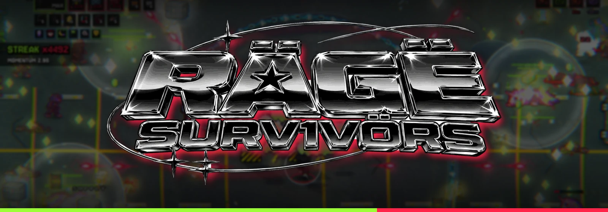

### SURVIVE THE LEAK · RAGE FOREVER

**A 30-wave survivors-like set in an underground rage-rap rave.**<br>
Auto-fire, dodge the crowd, stack weapons into evolutions and last until THE MAJOR LABEL walks in.

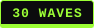 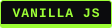   

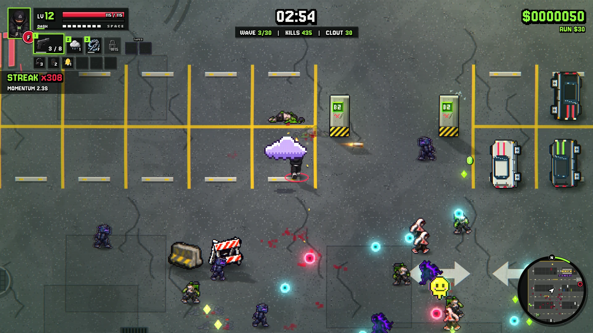

</div>

---

## ▶ About

You play **TWIZZYRICH**, a masked rage-rap artist trapped in **PARKING DECK B2**: a concrete garage turned into an
illegal rave. Fans, opps, clip farmers, security and label executives pour in over **30 numbered waves, one a minute**.
Your weapons fire on their own. You move, dash, grab XP, pick upgrades and try to stay standing until 30:00, when
**THE MAJOR LABEL** comes to end the run.

Every run opens with a photo dump of the spot, your character and a fictional drink, and then you get *geeked*. The
longer you last, the harder the trip hits: the picture warps and hallucinations join the crowd. They are real
enemies: pink ponies, stretched men, shuffle ghosts and giant sneakers.

The look is 2021 rage aesthetic (matte black, candy red, toxic green) drawn as crisp arcade pixel art, framed by an
80s arcade and fighting-game UI.

## ▶ Screenshots

<sub>Real 1920×1080 frames from the game. The gameplay shots come from full runs played by the developer's test bot.</sub>

| | |
|:---:|:---:|
| 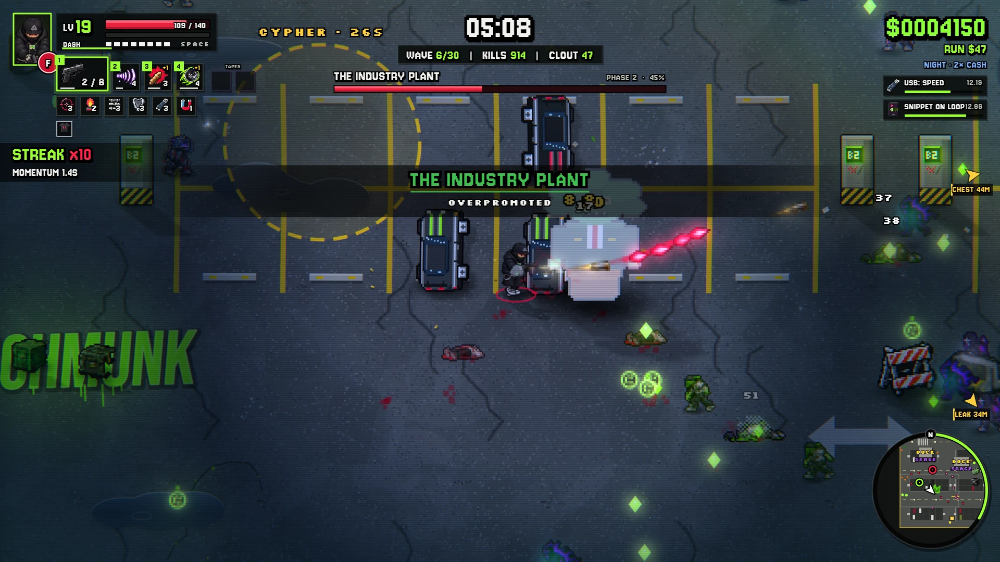 | 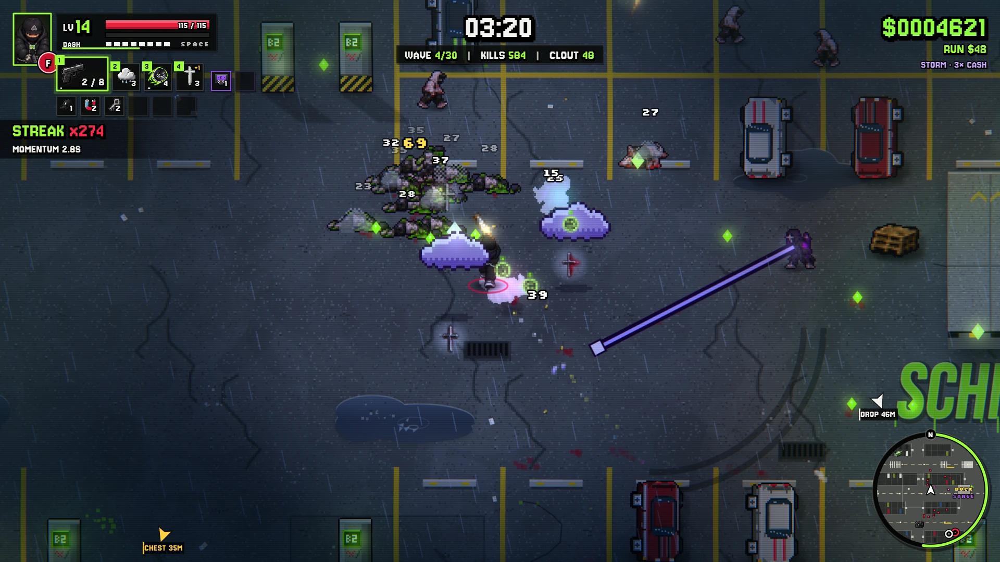 |
| **BOSS WAVE:** THE INDUSTRY PLANT at night | **STORM:** rain, lightning, the hardest crowd |
| 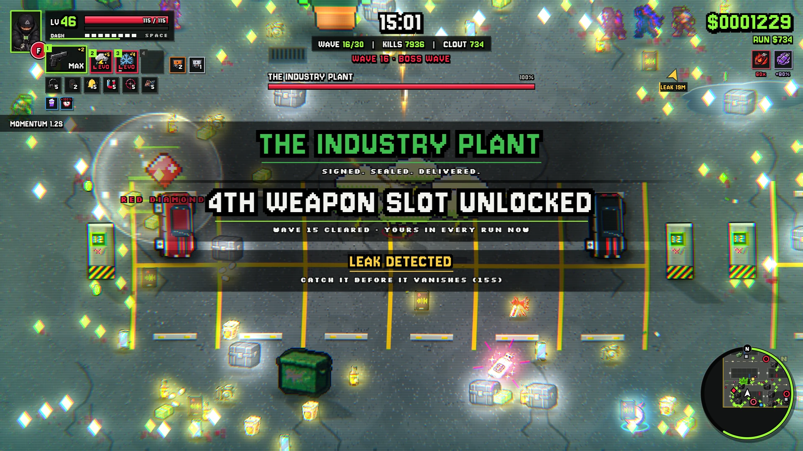 | 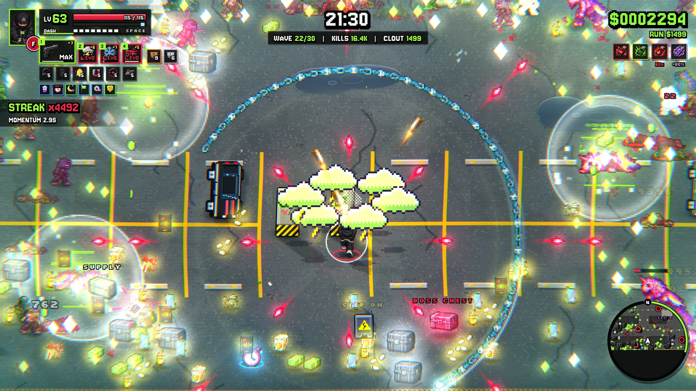 |
| **WAVE 15 cleared:** the 4th weapon slot opens for good | **21:30:** an evolved build against the late crowd |
| 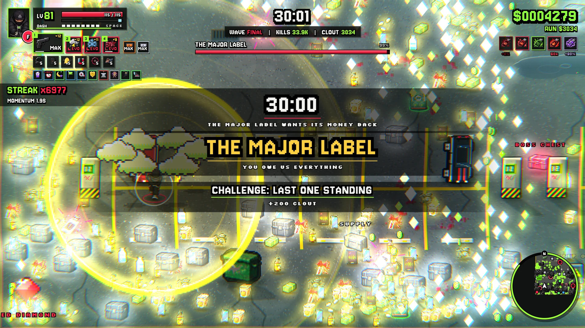 | 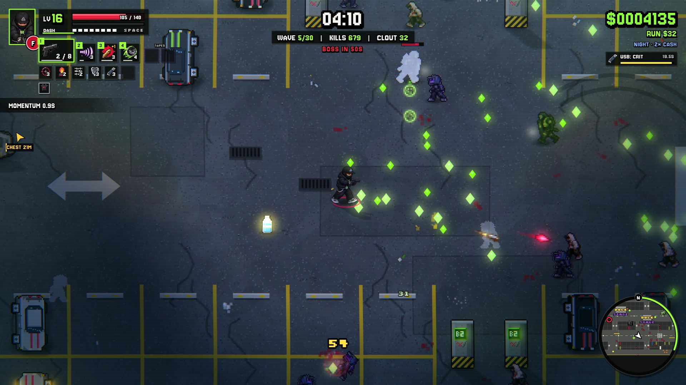 |
| **30:00:** THE MAJOR LABEL walks in | **NIGHT:** lights out, only the aisle lamps |
| 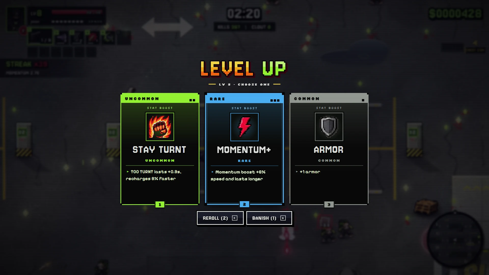 | 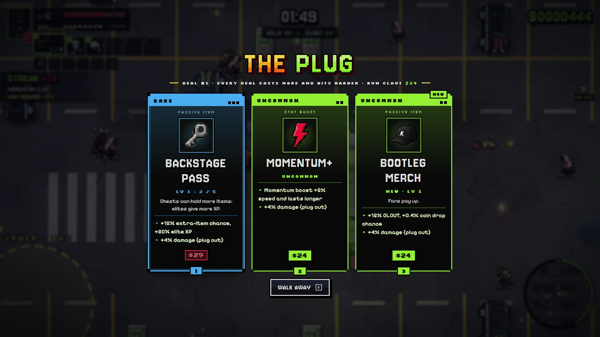 |
| **LEVEL UP:** weapons, MODS and TAPES | **THE PLUG** sells loot for your run's coins |

<div align="center">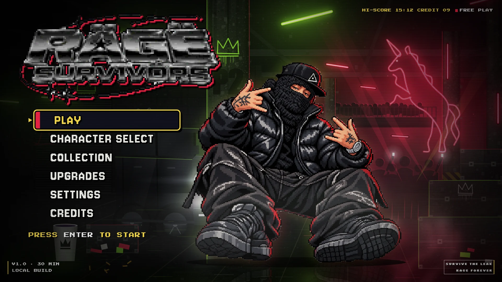<br><sub>Main menu</sub></div>

## ▶ Features

- **30 waves:** the HUD counts WAVE 7/30 next to the timer and calls out every new wave, with a BOSS WAVE every fifth
  one. The last 3 seconds of each wave bring nobody new, a short breather before the next.
- **4 bosses:** THE INDUSTRY PLANT, THE ALGORITHM, THE RAGE KING and THE MAJOR LABEL. Beating THE RAGE KING unlocks
  the **NO MERCY** stage.
- **19 weapons and 19 evolutions:** max a weapon, hold the matching passive item and open a chest to evolve it.
- **A build, not a pile:**
  - You start with 3 weapon slots and 2 TAPE slots.
  - Clearing WAVE 15 once opens the 4th weapon slot for good. FEATURE SLOT in UPGRADES sells the 5th.
  - Level-up cards lean on what you hold: your weapons' next levels and MODS (damage, attack speed, projectiles, size,
    range, crit, pierce, ricochet, chain, duration or a weapon's own effect).
- **15 TAPES:** the stat upgrades (damage, tempo, health, speed, crit, area, luck…) as cassettes you level up to
  LV 10. You get 2 slots, up to 4 with B-SIDE.
- **28 passive items, 11 consumables and 12 RAGE THUMBS:** run-wide modifiers, each with an upside and a catch.
- **71 STASH items** in four rarities: loot from chests, altars, elites, breakable props and THE PLUG. Every extra copy
  stacks.
- **Hidden synergies:** weapons, passives, TAPES and STASH items combine in ways the game never spells out. What you
  find fills a COLLECTION tab.
- **Three maps with their own payouts:**
  - **NORMAL:** 1× cash, items 20% stronger, shorter boss fights.
  - **NIGHT:** 2× cash, lights out and a tougher crowd.
  - **STORM:** 3× cash, night plus rain, lightning and the hardest crowd.
- **Room to move:** the crowd is the pressure, not the floor. Enemy attack warnings share a small budget and blasts
  from your own items share a sprite budget, so there is always a way out.
- **THE PLUG:** a dealer who sets up somewhere on the map in every run. Each deal costs more and hits harder.
- **Meta progression:** CL0UT currency, 14 permanent perks, unlocks, cosmetics ("drip"), challenges and a collection.
  Progress is saved in the browser.
- **Options:** gamepad support, automatic quality scaling, a CRT filter, a reduced-flash mode, and toggles for screen
  shake and damage numbers.
- **A second character is coming in a future update.**

## ▶ Install and play

The game is plain HTML, CSS and JavaScript. There is nothing to install or build.

**Option 1: open the file**

1. Download the repository (*Code → Download ZIP*) and unzip it, or clone it with Git.
2. Double-click `index.html`. The game opens in your browser straight from `file://`.

**Option 2: run a local server**

From the game folder:

```bash
python -m http.server 8000
```

Then open <http://localhost:8000>.

Works in current Chrome, Edge and Firefox. Fonts load from Google Fonts; without a connection the game uses fallback
fonts. Your progress lives in the browser's local storage. To start over, use *Settings → RESET ALL PROGRESS*.

## ▶ Controls

| Action | Keyboard | Gamepad |
|---|---|---|
| Move | WASD / arrow keys | left stick / D-pad |
| Dash (short invulnerability) | Space | A |
| Character ability | F / Q / Shift | B / X |
| Open a chest / deal with THE PLUG | E | X |
| Pause | Esc / P | Start |
| Pick a level-up card | mouse or 1–4 | — |
| Reroll / banish a card | R / B | — |

## ▶ Project structure

```
index.html        entry point, loads the scripts in order (works from file://)
style.css         menus, cards and overlays
audio/            soundtrack (menu and in-run playlists)
src/core/         utilities, save, input, procedural audio
src/gfx/          pixel art, sprites, icons, particles, WebGL post-processing (art embedded as data URIs)
src/data/         characters, weapons, items, loot, build layer, enemies, waves and timeline, maps, meta progression
src/game/         run core, player, combat, enemy AI, bosses, pickups, THE PLUG, arena, spawn director, renderer
src/ui/           canvas HUD, menu screens, in-run overlays, run intro
src/main.js       boot, game loop, resize
docs/             banner, logo, screenshots and README badges
```

## ▶ Credits

- **Game design, art direction and development:** DPaldus
- **Logo:** DPaldus
- **Sound effects:** generated in code at runtime (`src/core/audio.js`)
- **Music:** the recorded soundtrack in `audio/`
- **Fonts:** Bebas Neue, Permanent Marker, Jersey 10, Silkscreen, Pixelify Sans and Press Start 2P, loaded from
  [Google Fonts](https://fonts.google.com) under the SIL Open Font License 1.1. The fonts are not part of this
  repository and are not covered by its license.

## ▶ Disclaimer

Every character, enemy, item, drink and brand in the game is fictional. The game draws on the 2021 rage-rap
aesthetic but uses no real artists, songs, logos or artwork. Drug references are fictional and are not an
endorsement.

## ▶ License

**Copyright © 2026 DPaldus. All rights reserved.**

This is **not** open source. The repository is public so the game can be viewed and played. You may not copy,
modify, redistribute or use any part of it commercially without prior written permission from DPaldus. See
[LICENSE.md](LICENSE.md) for the full terms.

<div align="center"><sub>STAY GEEKED · STAY TURNT</sub></div>
